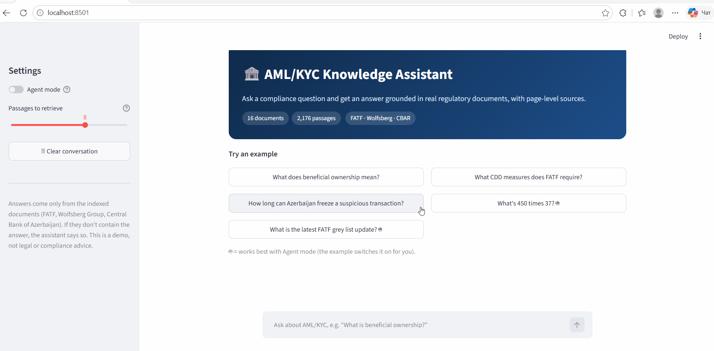
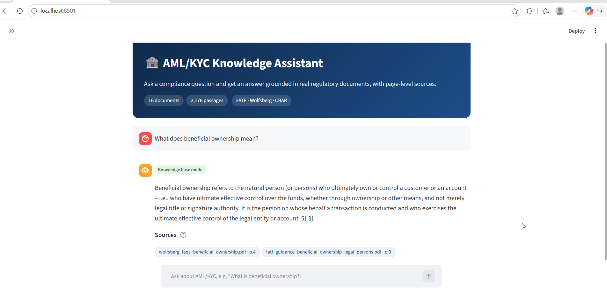
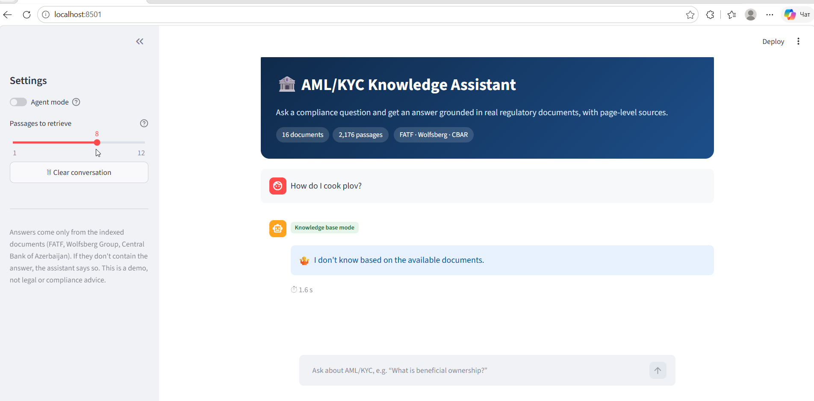
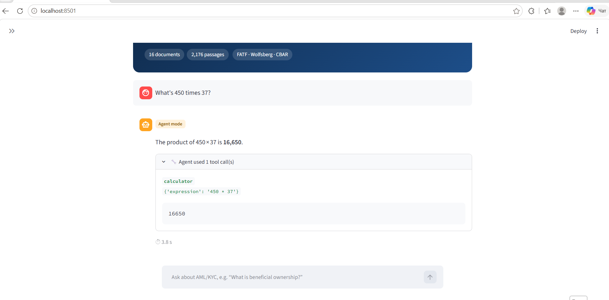
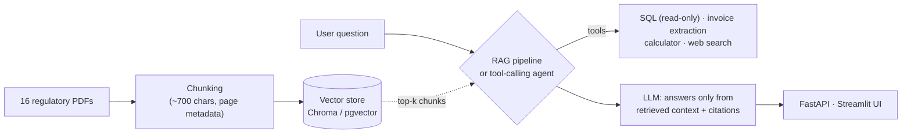

# AML/KYC Compliance RAG Assistant

[](https://github.com/emiliaismailova3/aml-kyc-rag-assistant/actions/workflows/tests.yml)


An assistant for a bank or fintech **compliance officer**. It does two jobs:

1. **Answers AML/KYC questions from real regulatory documents** (FATF, Wolfsberg Group, Central Bank of
   Azerbaijan), with every claim linked to a numbered source and page. When the documents don't contain
   the answer, it says "I don't know" instead of making one up.
2. **Checks client documents**: reads an invoice (text layer or OCR), extracts the company, VÖEN, amounts
   and dates, validates them, matches the company against a reference table, and sends anything
   uncertain to a human instead of guessing.

A tool-calling agent ties the two together (document search, read-only SQL over invoices and companies,
invoice extraction), and every piece is measured: what was checked, how, and what was not, is in
[`docs/VERIFICATION.md`](docs/VERIFICATION.md).



## Key results

| | |
|---|---|
| **Answer quality (RAGAS, 15-question gold set)\*** | faithfulness **0.83**, answer relevancy **0.84** |
| **Retrieval fix** | unanswered questions **5/15 → 1/15** after diagnosing a recall problem (top-k 4 → 8) |
| **Agent reliability** | agent runs ending with no answer **4/15 → 0/15** after tracing the loop and adding hard tool-call caps + a RAG fallback |
| **Agent tool choice** | correct tool on **16/16** routing scenarios (knowledge base, SQL, invoice, calculator, web) |
| **Hallucination guard on real scanned receipts** | invented values accepted **6/30 → 0/30** after adding a grounding check |
| **Read-only SQL tool** | 23 attack-style queries rejected (parser + view whitelist + read-only DB role) |
| **Engineering** | **300+ automated tests**, lint and a Docker smoke test in CI on every push |

\* One run with an LLM judge, measured before the reranker and the security prompt rules were added;
a re-run and a larger question set are the next step (see [Limitations](#limitations)).

## What it does

**Core**

- **RAG over 16 regulatory PDFs** (2,176 chunks): local embeddings, ChromaDB or PostgreSQL + pgvector,
  any OpenAI-compatible LLM (Groq / Together / OpenAI).
- **Citation-linked answers**: `[3]` in the answer maps to the `[3] file.pdf · p.12` source chip.
- **Tool-calling agent** (LangChain / LangGraph): knowledge-base search, read-only SQL,
  invoice extraction, calculator and web search, with hard limits against loops.
- **Invoice pipeline**: OCR (Tesseract, `eng+aze`) + LLM extraction → Pydantic validation → grounding check
  → company matching (VÖEN → name → fuzzy → embedding), with uncertain cases sent to human review.
- **Security**: PII masking in logs, traces and prompts; prompt-injection screening; read-only SQL.
- **Reliability**: own LLM client with retries, provider fallback, small/large model routing,
  latency and cost logging (`GET /stats`), escalation to a human when every provider fails.
- **Serving**: FastAPI backend, Streamlit UI, Docker Compose.

**Extensions** (working, lighter evaluation; details in [`docs/EVALUATION.md`](docs/EVALUATION.md)):
streaming answers, voice questions (Whisper), translation and summarization (en / az / ru / tr),
an MCP server exposing the tools, and scheduled document collection (Celery + Redis).

## Screenshots

| Answer with page-level sources | Honest refusal | Agent mode (tool call visible) |
|---|---|---|
|  |  |  |

## How it works



1. **Ingestion** ([`src/ingest.py`](src/ingest.py)): each PDF page is split into chunks that keep
   the file name and page number, so every answer can be traced to *file, page N*.
2. **Base RAG** ([`src/rag.py`](src/rag.py)): retrieves the top 8 chunks, numbers them in the prompt and
   instructs the model to answer only from them, cite by number, or say it doesn't know.
3. **Agent** ([`src/agent.py`](src/agent.py)): decides per question which tool to use; tool-call caps
   and a base-RAG fallback stop it from looping.
4. **Evaluation** ([`evals/`](evals/README.md)): RAGAS for answer quality, plus separate checks for
   routing, invoice extraction, security and latency.

## How the project evolved

Each stage started from a measurement, not a guess. Dates are from the commit history.

| When | Stage | What was measured and what changed |
|---|---|---|
| Sep 2026 | **RAG baseline** | Corpus of 16 regulatory PDFs, hand-written 15-question gold set, Chroma, FastAPI, agent, Docker |
| Oct 1–6 | **First live runs** | 13 issues found against a real LLM and fixed; RAGAS made resumable under API quotas; **refusals 5/15 → 1/15** after finding a recall problem (top-k 4 → 8); CI with lint and a Docker smoke test |
| Oct 10–11 | **Document checks** | Invoice OCR + LLM extraction with Pydantic validation, company matching, pgvector, read-only SQL tool (23 attack queries rejected), LLM client with retries and fallback |
| Oct 21 | **Real documents and security** | 30 real scanned receipts: **invented values accepted 6/30 → 0/30** with a grounding check; prompt-injection and PII defences with their own test sets; reranker tried and **kept only with an honest "no measured gain"** |
| Oct 22–23 | **Agent reliability** | Step-by-step traces showed the agent's answer being cut off by the step counter: hard tool-call caps + RAG fallback, **unanswered 4/15 → 0/15**, routing **14/16 → 16/16** |

Full numbers: [`docs/EVALUATION.md`](docs/EVALUATION.md) · what was and was not verified:
[`docs/VERIFICATION.md`](docs/VERIFICATION.md) · design decisions: [`docs/DECISIONS.md`](docs/DECISIONS.md).

## What's next

Turning the core into a **voice assistant for bank customers in Azerbaijani and Russian**: multilingual
retrieval (the current embedding model is English-only), hybrid BM25 + vector search, a larger eval set built
from real customer questions, Azerbaijani speech recognition and synthesis measured on recordings from
many speakers, and a public demo.

## Quickstart

```bash
python -m venv .venv && source .venv/bin/activate   # .venv\Scripts\activate on Windows
pip install -r requirements.txt
cp .env.example .env            # add a free GROQ_API_KEY from console.groq.com
python -m src.vectorstore       # build the index once (a few minutes on CPU)

python -m src.rag "What does beneficial ownership mean?"
python -m src.rag --retrieve-only "What does beneficial ownership mean?"   # no API key needed
```

API and UI: `uvicorn src.api:app` (docs at `localhost:8000/docs`) and `streamlit run src/streamlit_app.py`.
Or everything with Docker: `docker compose up --build` (API on :8000, UI on :8501).

Tests: `pytest -k "not internet_search"` (LLM calls are mocked, no API key needed).

## Limitations

- RAGAS was run once on 15 questions with an LLM judge, before the reranker and the security prompt rules
  were added; the agent itself is not scored by RAGAS yet. Re-running it on a larger set is the next step.
- The embedding model is English-only (`bge-small-en`), so questions in Azerbaijani or Russian are not
  supported well yet.
- Invoice and company-matching accuracy is measured on synthetic data; the real documents tested are 30 scanned receipts.
- Portfolio demo, not legal or compliance advice.

**Full measurements**, every extension and its verified status: [`docs/EVALUATION.md`](docs/EVALUATION.md) · [`docs/VERIFICATION.md`](docs/VERIFICATION.md) ·
design decisions: [`docs/DECISIONS.md`](docs/DECISIONS.md).

## Tech stack

Python 3.11+, LangChain 1.x / LangGraph, ChromaDB, PostgreSQL + pgvector, sentence-transformers
(`BAAI/bge-small-en-v1.5`), Groq / Together / OpenAI, Tesseract, FastAPI, Streamlit, Celery, RAGAS,
pytest, ruff, Docker, GitHub Actions.

## License

MIT for the code in this repository. The documents in `data/raw/` remain the property
of their publishers (FATF, the Wolfsberg Group, the Central Bank of the Republic of
Azerbaijan, UNODC); see [`data/raw/SOURCES.md`](data/raw/SOURCES.md) for attribution.
