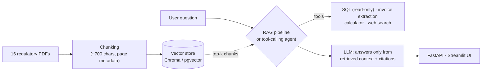

# AML/KYC Compliance RAG Assistant

[](https://github.com/emiliaismailova3/aml-kyc-rag-assistant/actions/workflows/tests.yml)


Ask a compliance question and get an answer **grounded in real regulatory documents**
(FATF, Wolfsberg Group, Central Bank of Azerbaijan), with every claim linked to a
numbered source and page. When the documents don't contain the answer, it says
"I don't know" instead of making one up.


## Key results

| | |
|---|---|
| **Answer quality (RAGAS, 15-question gold set)** | faithfulness **0.83**, answer relevancy **0.84** |
| **Retrieval fix** | unanswered questions **5/15 → 1/15** after diagnosing a recall problem (top-k 4 → 8) |
| **Hallucination guard on real scanned receipts** | invented values accepted **6/30 → 0/30** after adding a grounding check |
| **Engineering** | **305 automated tests**, lint and a Docker smoke test in CI on every push |

## What it does

- **RAG over 16 regulatory PDFs** (2,176 chunks): local embeddings, ChromaDB or PostgreSQL + pgvector,
  any OpenAI-compatible LLM (Groq / Together / OpenAI).
- **Citation-linked answers**: `[3]` in the answer maps to the `[3] file.pdf · p.12` source chip.
- **Tool-calling agent** (LangChain / LangGraph): knowledge-base search, read-only SQL,
  invoice extraction, calculator and web search, with hard limits against loops.
- **Invoice pipeline**: OCR (Tesseract) + LLM extraction → Pydantic validation → company matching,
  with uncertain cases sent to human review.
- **Security**: PII masking in logs, traces and prompts; prompt-injection screening.
- **Serving**: FastAPI backend, Streamlit UI, Docker Compose.

## Screenshots

| Answer with page-level sources | Honest refusal | Agent mode (tool call visible) |
|---|---|---|
|  |  |  |

## How it works



1. **Ingestion** ([`src/ingest.py`](src/ingest.py)): each PDF page is split into chunks that keep
   the file name and page number, so every answer can be traced to *file, page N*.
2. **Base RAG** ([`src/rag.py`](src/rag.py)): retrieves the top 8 chunks, numbers them in the prompt and
   instructs the model to answer only from them, cite by number, or say it doesn't know.
3. **Agent** ([`src/agent.py`](src/agent.py)): decides per question which tool to use; tool-call caps
   and a base-RAG fallback stop it from looping.
4. **Evaluation** ([`evals/`](evals/README.md)): RAGAS for answer quality, plus separate checks for
   routing, invoice extraction, security and latency.

## Quickstart

```bash
python -m venv .venv && source .venv/bin/activate   # .venv\Scripts\activate on Windows
pip install -r requirements.txt
cp .env.example .env            # add a free GROQ_API_KEY from console.groq.com
python -m src.vectorstore       # build the index once (a few minutes on CPU)

python -m src.rag "What does beneficial ownership mean?"
python -m src.rag --retrieve-only "What does beneficial ownership mean?"   # no API key needed
```

API and UI: `uvicorn src.api:app` (docs at `localhost:8000/docs`) and `streamlit run src/streamlit_app.py`.
Or everything with Docker: `docker compose up --build` (API on :8000, UI on :8501).

Tests: `pytest -k "not internet_search"` (LLM calls are mocked, no API key needed).

## Limitations

- RAGAS was run once on 15 questions with an LLM judge; the agent itself is not scored by RAGAS yet.
- Invoice and company-matching accuracy is measured on synthetic data; the real documents tested are 30 scanned receipts.
- Portfolio demo, not legal or compliance advice.

**Full measurements**, every extension (streaming, MCP server, voice, scheduled collection, reliability layer)
and their verified status: [`docs/EVALUATION.md`](docs/EVALUATION.md) · [`docs/STATUS.md`](docs/STATUS.md) ·
design decisions: [`docs/DECISIONS.md`](docs/DECISIONS.md).

## Tech stack

Python 3.11+, LangChain 1.x / LangGraph, ChromaDB, PostgreSQL + pgvector, sentence-transformers
(`BAAI/bge-small-en-v1.5`), Groq / Together / OpenAI, Tesseract, FastAPI, Streamlit, Celery, RAGAS,
pytest, ruff, Docker, GitHub Actions.

## License

MIT for the code in this repository. The documents in `data/raw/` remain the property
of their publishers (FATF, the Wolfsberg Group, the Central Bank of the Republic of
Azerbaijan, UNODC); see [`data/raw/SOURCES.md`](data/raw/SOURCES.md) for attribution.
